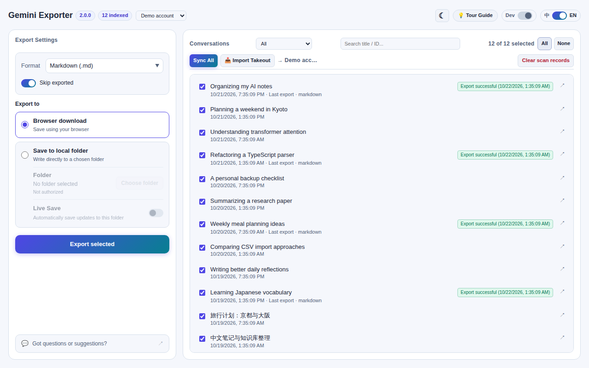

# 🌌 Gemini Exporter - Save All Your Chats

<p align="left">
  <b>English</b> | <a href="./README_zh.md">简体中文</a>
</p>

**Your Gemini conversations are worth keeping.** Gemini Exporter is a **free, open-source, local-first** extension that saves Google Gemini chats as files you control. No API key, account registration, analytics, or tracking.

**[Install from the Chrome Web Store](https://chromewebstore.google.com/detail/gemini-exporter/ldpbiafkgjlaooeplkiooljccpalpkgf?utm_source=github&utm_medium=readme_en&utm_campaign=github_repo)** · [MIT License](./LICENSE)


## ✨ What you can do

- **Save one chat or many.** Export the current conversation in one click, or scan and select conversations for batch backup.
- **Choose your format.** **Markdown, HTML, PDF, or JSON**, with available images and file attachments.
- **Choose where files go.** Use browser downloads or write directly to a local folder. Multiple browser-download files are automatically bundled into a ZIP.
- **Keep up with new replies.** Incremental scans, skip-unchanged exports, and **Live Save** for Markdown in a chosen local folder.
- **Bring older chats back.** Import Google Takeout ZIP archives to supplement Gemini history accessible online.

English/简体中文 interface · Dark/light theme · Export status and retry tools

## 📸 Preview



[Dark-mode workbench & Live Save](./store_assets/screenshot_2_1280x800.png) · [Quick-export popup](./store_assets/screenshot_popup_v2.png)

*Screenshots were captured from the actual v2 extension with anonymous example conversations.*

## 🚀 Get started

1. **Install the extension** and open a conversation at [Google Gemini](https://gemini.google.com).
2. **Choose what to save.** Use **Export Current Conversation** in the popup, or open the **Workbench**, click **Sync All**, and select chats.
3. **Export your files.** In the Workbench, pick a format and either **Browser download** or **Save to local folder**, then click **Export selected**.

**Want automatic updates?** In the Workbench, choose **Save to local folder**, authorize a folder, select **Markdown**, and enable **Live Save**. It pauses if you switch to browser download or another format.

**Have older conversations?** Import an original [Google Takeout](https://takeout.google.com/settings/takeout/custom/gemini) ZIP in the Workbench.

*Note:* **Sync All** updates the conversation list; **Export selected** creates backup files. Some expired source attachments may no longer be recoverable.

## 🔒 Privacy first

Your exports are processed on your device, not on a developer-operated server. The extension uses your existing Gemini browser session to retrieve requested conversations and resources from Google. **Gemini is the currently supported source**; other AI platforms are not yet supported.

## 🛠️ Build from source

```bash
git clone https://github.com/OTLFrostA/gemini-exporter.git
cd gemini-exporter
npm install && npm run build
```

In Chrome, open `chrome://extensions/`, enable **Developer mode**, and select **Load unpacked** → the cloned folder.

## 📚 More information

[User guide & FAQ](./docs/USER_GUIDE.md) · [Privacy policy](./docs/PRIVACY_POLICY.md) · [v2 architecture](./src/README.md) · [Testing guide](./tests/README.md)

Gemini Exporter is independent and **not affiliated with or endorsed by Google**. Google and Gemini are trademarks of Google LLC.
