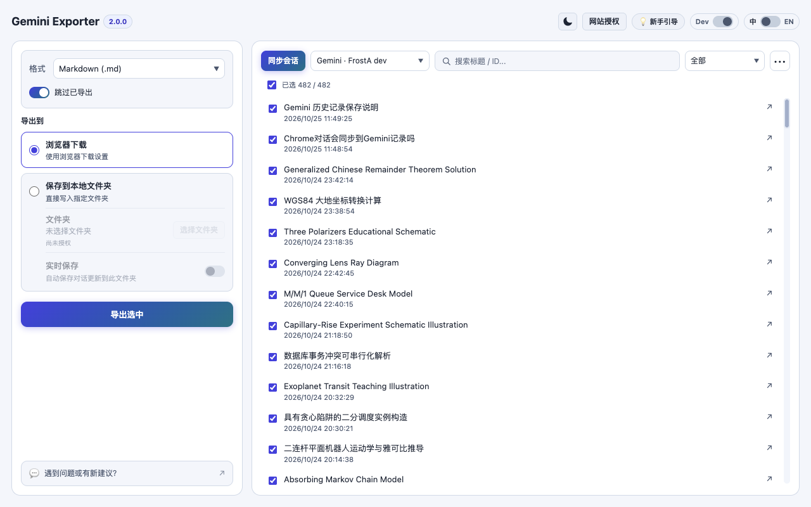

# 🌌 Gemini Exporter - Save All Your Chats

<p align="left">
  <a href="./README.md">English</a> | <b>简体中文</b>
</p>

**你的 Gemini 对话，值得自己保存。** Gemini Exporter 是一款**免费、开源、完全在本地处理导出的**浏览器扩展，把 Google Gemini 对话保存成自己掌控的文件。无需 API Key、另行注册账号，也没有统计追踪。

**[前往 Chrome 应用商店安装](https://chromewebstore.google.com/detail/gemini-exporter/ldpbiafkgjlaooeplkiooljccpalpkgf?utm_source=github&utm_medium=readme_zh&utm_campaign=github_repo)** · [MIT 开源协议](./LICENSE)

## ✨ 核心功能

- **单篇或批量备份**：一键保存当前对话，或扫描历史后按需选择批量导出。
- **四种格式**：**Markdown、HTML、PDF、JSON**，支持保存可获取的图片与文件附件。
- **两种保存方式**：浏览器下载或直接写入本地文件夹；浏览器下载多个文件时自动打包 ZIP。
- **持续保存更新**：增量扫描、跳过未变化的已导出对话，以及保存到本地文件夹的 **Markdown 实时保存**。
- **补全旧对话**：导入 Google Takeout 原始 ZIP，补充 Gemini 网页当前可访问的历史。

中英双语 · 明暗主题 · 导出状态与失败重试

## 📸 产品截图



[深色模式及实时保存](./store_assets/screenshot_2_1280x800.png) · [快捷导出弹窗](./store_assets/screenshot_popup_v2.png)

*截图来自实际运行的 v2 扩展，所有对话均为匿名示例数据。*

## 🚀 三步开始

1. **安装插件**，打开 [Google Gemini](https://gemini.google.com) 中的对话。
2. **选择要保存的内容**：在插件弹窗点击**导出当前对话**；或打开**工作台**，点击**同步会话**并勾选需要备份的对话。
3. **导出文件**：在工作台选择格式与**浏览器下载 / 保存到本地文件夹**，点击**导出选中**。

**想自动保存？** 在工作台选择**保存到本地文件夹**，授权目录、选择 **Markdown**，然后开启**实时保存**。切换到其他格式或浏览器下载时会暂停。

**想补全更早历史？** 在工作台导入 [Google Takeout](https://takeout.google.com/settings/takeout/custom/gemini) 原始 ZIP。

*注意：***同步会话**只更新会话目录，**导出选中**才会生成备份文件；部分过期附件可能无法恢复。

## 🔒 隐私优先

导出处理在本机完成，**不会上传到开发者运营的服务器**。插件通过现有的 Gemini 登录会话从 Google 获取你请求的对话与资源。**目前仅支持导出 Gemini**，尚不支持其他 AI 平台。

## 🛠️ 从源码安装

```bash
git clone https://github.com/OTLFrostA/gemini-exporter.git
cd gemini-exporter
npm install && npm run build
```

打开 Chrome 的 `chrome://extensions/`，开启**开发者模式**，点击**加载已解压的扩展程序**并选择仓库目录。

## 📚 更多文档

[使用指南与常见问题](./docs/USER_GUIDE_zh.md) · [隐私政策](./docs/PRIVACY_POLICY.md) · [v2 架构](./src/README.md) · [测试指南](./tests/README.md)

Gemini Exporter 是独立开源项目，**与 Google 无隶属或背书关系**。Google 和 Gemini 为 Google LLC 的商标。
