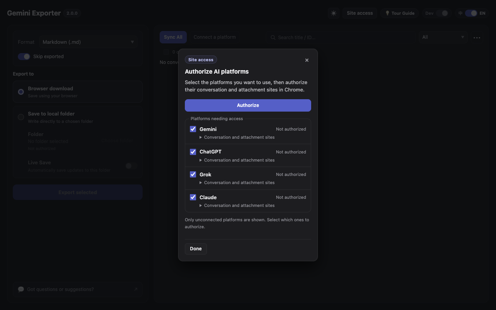
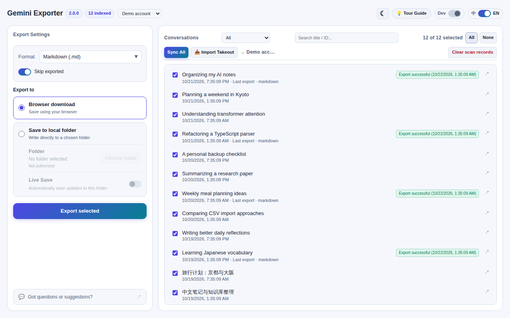

# Gemini Exporter · User guide

[← Back to README](../README.md) · [简体中文](./USER_GUIDE_zh.md)

Gemini Exporter saves supported Google Gemini conversations locally. The optional Encrypted Vault can also back up conversation records to a local encrypted folder or sync them to a compatible server you configure.

## Connect a platform

Open **Site access** in the Workbench, select the platforms you need, and click **Authorize**. Only platforms still needing permission appear; already authorized platforms are hidden. Unchecking a platform does not revoke its existing access. To revoke access, use Chrome’s extension settings. After authorization, sign in on the source website and select its account in the Workbench.

## Export formats and delivery

| Format | Typical use |
| --- | --- |
| **Markdown** (`.md`) | Notes, Obsidian, Logseq, or readable long-term archives |
| **HTML** (`.html`) | Offline browser reading, including formatted math and light/dark viewing |
| **PDF** (`.pdf`) | Portable reading and sharing; compiled locally via Typst/WASM |
| **Word** (`.docx`) | Editable documents; supported equations are native Word math |
| **JSON** (`.json`) | Machine-readable structured conversation archives |

Images and other available attachments may be included alongside Markdown, HTML, or JSON in `assets/` and `files/`. PDF and Word embed applicable visual resources and may include original attachments as separate files.

Choose either **Browser download** or **Save to local folder** in the Workbench. Browser downloads bundle multiple files into one ZIP; extract it as a whole to preserve links to attachments. Local-folder delivery writes files directly, with Markdown, HTML and JSON documents written before their attachments. Large batches generally work better with an authorized folder than in-memory browser ZIP packaging.

## Export the current conversation

1. Open a supported conversation on [Gemini](https://gemini.google.com) while signed in.
2. In the extension popup, select **Markdown**, **PDF**, **HTML**, **Word**, or **JSON**.
3. Click **Export Current Conversation** to start a browser download.

## Back up several conversations

1. Open the **Workbench** from the popup and click **Sync All**.
2. Search or filter your local conversation catalog and select the conversations to save.
3. Choose a format and output destination. For local folder delivery, choose and authorize a folder first.
4. Click **Export selected**. Export status indicators show completed exports, changed conversations, failures, or attachment issues.

**Sync is not a file backup.** It discovers/updates accessible conversation records; **Export selected** creates files. Previously saved local conversations are not removed merely because a later scan cannot find them.

**Skip exported** is designed to skip only a fully completed, matching-format export when the known source has not changed. Re-export a chat when its contents have changed or when you want a different format.

## Live Save

Live Save writes Markdown updates to a user-authorized local folder when Gemini completes new replies.

1. In the Workbench, select **Save to local folder** and click **Choose folder**.
2. Select **Markdown (.md)**.
3. Enable **Live Save** inside the local-folder card.

Switching to **Browser download** or a non-Markdown format **pauses** Live Save; your on/off preference remains saved. If browser permissions expire after a restart, reauthorize the folder when prompted.

## Encrypted Vault

The vault is separate from **Live Save** and from ordinary file exports. In the Workbench, choose **Manage** on the **E2EE Encrypted Vault** card.

1. Generate a GEK1 master key, save it offline, and confirm to activate it. You cannot display it again after confirmation. To use an existing vault, enter its original GEK1 key instead.
2. Choose **Local Encrypted Folder** and authorize a folder, or choose **Cloud Vault Server** and enter the HTTPS URL of a v2-compatible server and its access code if required. Use **Create & Connect Cloud Vault** with a new key, or **Unlock Existing Cloud Vault** with the original key.
3. Connecting enables automatic backup. Use the vault toggle to pause it or choose **Sync Now** to sync manually. The vault backs up the conversation catalog by default; it does not back up exported files or original attachment bytes.

Keep the original key to unlock existing data or pair another browser. If the vault reports a key mismatch, enter its original key. Resetting the vault is destructive and cannot recover data encrypted with a lost key.

On a connected cloud vault, choose **Clear Cloud Backup** and confirm to erase its encrypted server records. Local conversations stay on each device. Automatic backup pauses on each device when it detects the reset. Turn backup on again only when you intend to upload local history to the cleared vault.

## Import older history with Google Takeout

1. Download a Gemini archive from [Google Takeout](https://takeout.google.com/settings/takeout/custom/gemini).
2. In the Workbench, choose the intended account and import the original ZIP (no manual extraction required).
3. Select imported conversations and export files as usual.

Takeout can supplement what Gemini exposes to an online scan. It cannot guarantee that all unavailable, deleted, or expired attachments will be recoverable.

## Common questions

**Do I need an API key or paid Gemini plan?** No. Gemini Exporter uses your existing signed-in browser session; available conversation history depends on your account and Gemini's services.

**Where did the ZIP option go?** ZIP is packaging, not an export format. It is automatic for multi-file browser downloads; local-folder exports write files directly.

**Can Live Save write PDF or HTML?** No. Automatic Live Save currently targets Markdown in an authorized local folder.

**Why is an attachment missing?** Some source files and generated images may have expired or become inaccessible. The exporter reports resource problems when it detects them but cannot reconstruct bytes the source no longer serves.

Export and Live Save download remote images from the conversation platform’s allowed hosts. External images appear as placeholders with source links when available.

**Does PDF require access to my installed fonts?** PDF compiles locally. The renderer supports bundled offline fonts, so access to installed fonts is not a prerequisite for generating a PDF.

**Can I back up ChatGPT, Claude, or Grok?** Source builds include experimental ChatGPT, Claude and Grok support. Authorize the platforms you need through onboarding or Site access. Chrome requests only the selected platforms’ conversation and attachment sites. Sign in on the platform websites, then select an account, sync and export. Keep a signed-in grok.com tab open for Grok synchronization and export. Missing attachments, unsupported tools and ambiguous branches may produce partial exports.

**What happens to ChatGPT questionnaires and interactive cards?** Exports preserve the provider's full Markdown fallback. Dynamic syntax alone does not mark that textual export incomplete. For loop-generated forms, literal question/option data is also recovered from arrays referenced by the template, without running component code. A dynamic component without a usable fallback remains incomplete because literal recovery cannot establish full text coverage. Buttons become labels; exports do not reproduce interactive state, submit forms or run ChatGPT actions. Selected answers and calculated results are preserved when they are present in the source fallback or subsequent conversation messages.

For developer documentation, see [v2 module architecture](../src/README.md) and the [testing guide](../tests/README.md). Read the [privacy policy](./PRIVACY_POLICY.md) for data-handling details.

## Import an OpenAI / ChatGPT export ZIP

1. Connect ChatGPT and select the intended ChatGPT account in the Workbench. The export does not identify a workspace, so choose the correct workspace account yourself; `user.json`, when present, must match its signed-in user.
2. Open **More actions → Import OpenAI ZIP** and select the original OpenAI data-export ZIP. Manifest-listed conversation shards are supported.
3. Select the imported conversations and export normally. The importer uses the current conversation branch and preserves available source times, model names, reasoning and citations. Existing local conversations use the normal merge rules.

Keep the Workbench page open to export original ZIP attachments. After closing or reloading it, reimport the ZIP to restore its attachment readers. ZIP bytes stay outside stored conversation facts. Missing attachments produce a partial result; file-library records alone never become conversations. An export with an empty `conversations.json` reports that no conversation bodies were supplied.

**What happens when ChatGPT returns 429?** The current export stops immediately and the account cools down for at least one hour, or longer if required by `Retry-After`. The UI shows the reason and cooldown deadline; retry manually after it expires. The account deadline survives workbench reloads and browser restarts. Diagnostics retain rate-limit and cooldown observations.

Stopping or cancelling a Markdown, HTML or JSON browser export still delivers prepared documents and completed attachments together. Conversations with unfinished attachment processing are not recorded as successful. Packaging or delivery failures are reported separately. PDF and Word must finish rendering before delivery; files already written in folder mode remain saved.

Within one export task, ChatGPT document reads and attachment-locator requests observe the same account cooldown.

**Does source reply completion determine export success?** It does not determine the outcome by itself. Finished replies, interruptions, handoffs, user-message tails, tool steps and unconfirmed completion describe the source. Complete body coverage with successful file delivery remains a successful export; actual missing content, missing attachments and delivery failures are reported separately. Explicit completion on a hidden assistant node can establish termination without exposing that node's hidden content in the exported file.
