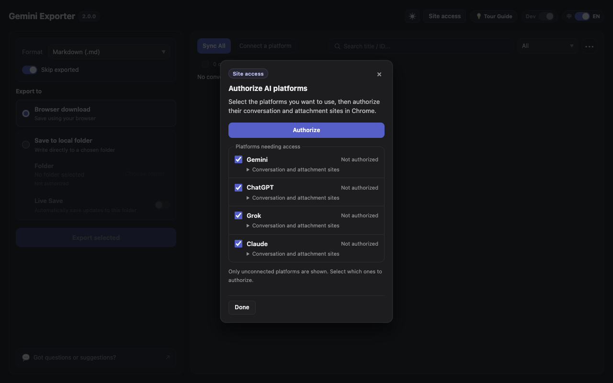

# Gemini Exporter · User guide

[← Back to README](../README.md) · [简体中文](./USER_GUIDE_zh.md)

Gemini Exporter saves supported Google Gemini conversations locally. It does **not** provide hosted backup or cloud synchronization.

## Connect a platform

Open **Site access** in the Workbench, select the platforms you need, and click **Authorize**. Only platforms still needing permission appear; already authorized platforms are hidden. Unchecking a platform does not revoke its existing access. To revoke access, use Chrome’s extension settings. After authorization, sign in on the source website and select its account in the Workbench.

## Export formats and delivery

| Format | Typical use |
| --- | --- |
| **Markdown** (`.md`) | Notes, Obsidian, Logseq, or readable long-term archives |
| **HTML** (`.html`) | Offline browser reading, including formatted math and light/dark viewing |
| **PDF** (`.pdf`) | Portable reading and sharing; compiled locally via Typst/WASM |
| **JSON** (`.json`) | Machine-readable structured conversation archives |

Images and other available attachments may be included alongside Markdown, HTML, or JSON in `assets/` and `files/`. PDF embeds applicable visual resources and may output original attached files separately.

Choose either **Browser download** or **Save to local folder** in the Workbench. When a browser download contains multiple files, they are automatically packaged as one ZIP. Local-folder delivery writes files directly without this ZIP step. Large batches generally work better with an authorized folder than in-memory browser ZIP packaging.

## Export the current conversation

1. Open a supported conversation on [Gemini](https://gemini.google.com) while signed in.
2. In the extension popup, select **Markdown**, **PDF**, **HTML**, or **JSON**.
3. Click **Export Current Conversation** to start a browser download.

## Back up several conversations

1. Open the **Workbench** from the popup and click **Sync All**.
2. Search or filter your local conversation catalog and select the conversations to save.
3. Choose a format and output destination. For local folder delivery, choose and authorize a folder first.
4. Click **Export selected**. Export status indicators show completed exports, changed conversations, failures, or attachment issues.

**Sync is not a file backup.** It discovers/updates accessible conversation records; **Export selected** creates files. Previously saved local conversations are not removed merely because a later scan cannot find them.

**Skip exported** is designed to skip only a fully completed, matching-format export when the known source has not changed. Re-export a chat when its contents have changed or when you want a different format.

## Live Save

Live Save writes Markdown updates to a user-authorized local folder when Gemini completes new replies.

1. In the Workbench, select **Save to local folder** and click **Choose folder**.
2. Select **Markdown (.md)**.
3. Enable **Live Save** inside the local-folder card.

Switching to **Browser download** or a non-Markdown format **pauses** Live Save; your on/off preference remains saved. If browser permissions expire after a restart, reauthorize the folder when prompted.

## Import older history with Google Takeout

1. Download a Gemini archive from [Google Takeout](https://takeout.google.com/settings/takeout/custom/gemini).
2. In the Workbench, choose the intended account and import the original ZIP (no manual extraction required).
3. Select imported conversations and export files as usual.

Takeout can supplement what Gemini exposes to an online scan. It cannot guarantee that all unavailable, deleted, or expired attachments will be recoverable.

## Common questions

**Do I need an API key or paid Gemini plan?** No. Gemini Exporter uses your existing signed-in browser session; available conversation history depends on your account and Gemini's services.

**Where did the ZIP option go?** ZIP is packaging, not an export format. It is automatic for multi-file browser downloads; local-folder exports write files directly.

**Can Live Save write PDF or HTML?** No. Automatic Live Save currently targets Markdown in an authorized local folder.

**Why is an attachment missing?** Some source files and generated images may have expired or become inaccessible. The exporter reports resource problems when it detects them but cannot reconstruct bytes the source no longer serves.

**Why does PDF ask to access local fonts?** The local PDF renderer may request Chrome's Local Font Access permission to use installed fonts, especially for non-Latin scripts. Your document is compiled locally.

**Can I back up ChatGPT, Claude, or Grok?** Source builds include experimental ChatGPT, Claude and Grok support. Authorize the platforms you need through onboarding or Site access. Chrome requests only the selected platforms’ conversation and attachment sites. Sign in on the platform websites, then select an account, sync and export. Keep a signed-in grok.com tab open for Grok synchronization and export. Missing attachments, unsupported tools and ambiguous branches may produce partial exports.

**What happens to ChatGPT questionnaires and interactive cards?** Exports preserve the provider's full Markdown fallback. Dynamic syntax alone does not mark that textual export incomplete. For loop-generated forms, literal question/option data is also recovered from arrays referenced by the template, without running component code. A dynamic component without a usable fallback remains incomplete because literal recovery cannot establish full text coverage. Buttons become labels; exports do not reproduce interactive state, submit forms or run ChatGPT actions. Selected answers and calculated results are preserved when they are present in the source fallback or subsequent conversation messages.

For developer documentation, see [v2 module architecture](../src/README.md) and the [testing guide](../tests/README.md). Read the [privacy policy](./PRIVACY_POLICY.md) for data-handling details.
